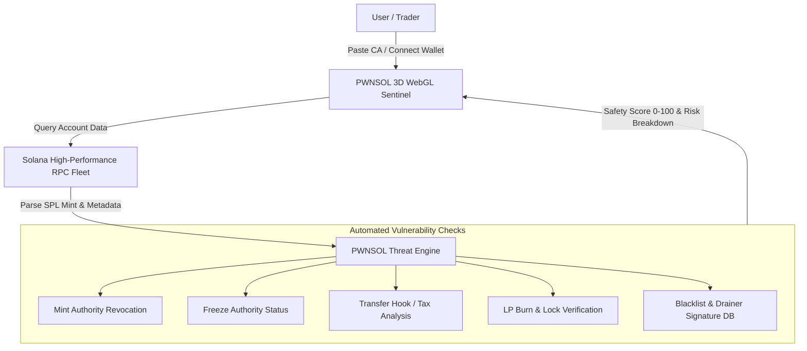

# PWNSOL · Live Web3 Exploit Sentinel & Threat Scanner on Solana

<p align="center">
  
</p>

<p align="center">
  <b>Real-time Solana exploit monitor, drainer detector, rug-pull sentinel, and 1-click token security scanner. What's getting pwned in Web3.</b>
</p>

<p align="center">
  <a href="https://pwnsol.xyz"></a>
  <a href="https://x.com/pwnsolpf"></a>
  <a href="https://solana.com"></a>
  
</p>

---

## ⚡ Overview

Inspired by the simplicity and raw utility of [pwn.watch](https://pwn.watch), **PWNSOL** monitors, tracks, and neutralizes live security threats, drainer scripts, and malicious token contracts across the Solana blockchain:

1. **Instant Contract Threat Scanner**: Paste any Solana Contract Address (CA), Mint, or Pump.fun pair to immediately run a multi-vector security verification:
   - **Mint Authority**: Verifies whether the deployer retains unilateral mint rights.
   - **Freeze Authority**: Flags contracts capable of freezing victim wallets.
   - **Transfer Hook / Tax Traps**: Identifies 99% sell tax traps and honeypot mechanisms.
   - **Holder Concentration**: Analyzes top 10 holders clustering and stealth deployer wallets.
   - **LP Lock & Burn Proof**: Confirms Raydium / Meteora LP burn transactions.
2. **Live Incident Stream (What's Getting Pwned)**: Real-time telemetry feed of blocked phishing permits, blacklisted drainers, and intercepted rug attempts.
3. **Wallet Drainer Shield**: Connect Phantom or Solflare to scan your account for open token delegations or unverified contract approvals.

---

## 🏗 Architecture



---

## 💻 CLI Scanner

```bash
# Run standalone terminal security audit on any Solana CA
npx @pwnsol/scanner <TOKEN_CA>

# Example:
npx @pwnsol/scanner So11111111111111111111111111111111111111112
```

---

## 🌐 Official Channels

- **Live Sentinel App**: [https://pwnsol.vercel.app](https://pwnsol.vercel.app)
- **GitHub**: [https://github.com/soldevut/pwnsol](https://pwnsol.vercel.app)

---

## 📄 License

Dual-licensed under Apache 2.0 or MIT.
